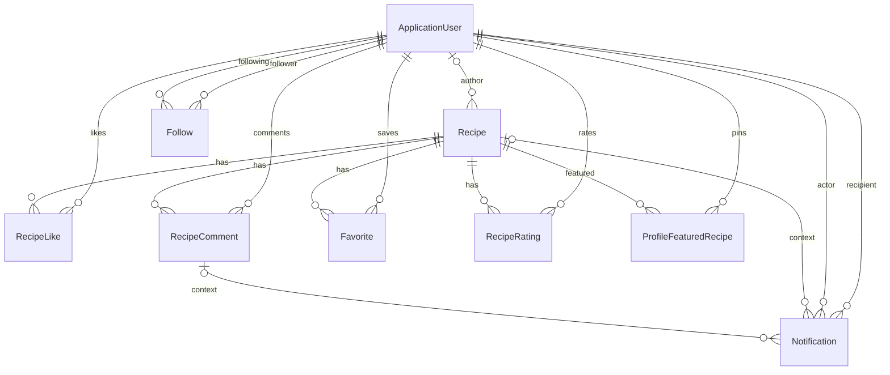

# Thiết kế dữ liệu

CookShare dùng PostgreSQL, EF Core 8 và Npgsql. Schema chuẩn được mô tả bởi [ApplicationDbContext](../CookShare/Data/ApplicationDbContext.cs), [models](../CookShare/Models/) và [migrations](../CookShare/Migrations/). Tài liệu mô tả mã trên `develop`, không khẳng định database triển khai đã áp dụng đủ migration.

## Các bảng

| Model / bảng | Nội dung và khóa |
| --- | --- |
| `ApplicationUser` / `AspNetUsers` | Tài khoản Identity; PK `Id` kiểu text |
| `Recipe` / `Recipes` | Công thức; PK `Id` integer |
| `RecipeLike` / `RecipeLikes` | Lượt thích; PK `Id`, duy nhất `(UserId, RecipeId)` |
| `RecipeComment` / `RecipeComments` | Bình luận; PK `Id` |
| `Favorite` / `Favorites` | Công thức đã lưu; PK `Id`, duy nhất `(UserId, RecipeId)` |
| `Follow` / `Follows` | Theo dõi có hướng; PK `Id`, duy nhất `(FollowerId, FollowingId)` |
| `RecipeRating` / `RecipeRatings` | Đánh giá; PK `Id`, duy nhất `(UserId, RecipeId)` |
| `Notification` / `Notifications` | Thông báo theo người nhận; PK `Id`, duy nhất `EventKey` |
| `ProfileFeaturedRecipe` / `ProfileFeaturedRecipes` | Công thức ghim; PK ghép `(UserId, RecipeId)`, duy nhất `(UserId, DisplayOrder)` |

Identity còn có các bảng roles, claims, logins, user roles và tokens do EF Identity quản lý. Không sửa trực tiếp password hash hoặc token trong database.

## Tài khoản và hồ sơ

`ApplicationUser` kế thừa `IdentityUser`. Ngoài trường Identity, hồ sơ có:

| Trường | Kiểu PostgreSQL | Nullable |
| --- | --- | --- |
| `DisplayName` | character varying(100) | Có |
| `AvatarUrl` | character varying(500) | Có |
| `CoverImageUrl` | character varying(500) | Có |
| `Bio` | character varying(300) | Có |
| `CreatedAt` | timestamp with time zone | Không |

`NormalizedUserName` có unique index; index `NormalizedEmail` không unique. Identity được cấu hình `RequireUniqueEmail`, nhưng đây là kiểm tra ứng dụng, không phải ràng buộc unique email ở database.

Ghim công thức dùng ba vị trí `DisplayOrder` từ 1 đến 3. Unique index và check constraint giữ giới hạn ba vị trí khi có request đồng thời; quyền ghim công thức của chính mình được kiểm tra tại ứng dụng. Xem [Creator profile](CREATOR_PROFILE.md).

## Công thức

| Trường | Kiểu PostgreSQL | Nullable / giới hạn |
| --- | --- | --- |
| `Id` | integer, identity | PK |
| `Name` | character varying(200) | Không NULL |
| `Description` | text | Không NULL |
| `Ingredients` | text | Không NULL |
| `Instructions` | text | Không NULL |
| `Image` | text | Có; tham chiếu ảnh, không chứa file |
| `Category` | character varying(100) | Không NULL |
| `UserId` | character varying(450) | Có; FK → AspNetUsers.Id |
| `CreatedAt` | timestamp with time zone | Không NULL |
| `Servings` | integer | 1–20; mặc định database là 4 |
| `PreparationTimeMinutes` | integer | Có; 1–1440 nếu có |
| `CookingTimeMinutes` | integer | Có; 1–1440 nếu có |
| `Difficulty` | character varying(16) | Có; Easy/Medium/Hard |
| `Source` | character varying(32) | Có |
| `ExternalId` | character varying(128) | Có |
| `SourceUrl` | character varying(2000) | Có |

`UserId` nullable để giữ công thức cũ chưa gán tác giả. Create mới lấy tác giả từ Identity ở server. Metadata nguồn nhận diện công thức import: `Source` và `ExternalId` phải cùng NULL hoặc cùng khác NULL; cặp khác NULL có unique index.

Thời gian/độ khó của dữ liệu cũ giữ NULL, còn khẩu phần được migration mặc định 4. Xem [khẩu phần và metadata](RECIPE_COOKING.md), [ảnh upload](RECIPE_IMAGES.md) và [seeding](RECIPE_SEEDING.md).

## Tương tác và thông báo

Like/Favorite/Rating tham chiếu người dùng và công thức; Comment có `Content` bắt buộc, tối đa 1000 ký tự. Follow có hai FK người dùng, không cho phép tự theo dõi. Rating có check constraint số sao 1–5; quy tắc không tự đánh giá công thức mình được kiểm tra trong ứng dụng.

Notification gồm `RecipientId`, `ActorId`, `Type` (20 ký tự), `Message` nullable (500), `RecipeId`/`CommentId` nullable, `EventKey` (200), `IsRead` và `CreatedAt`. Unique `EventKey` chống tạo trùng sự kiện; index `(RecipientId, IsRead, CreatedAt)` hỗ trợ danh sách theo người nhận. Quyền đọc/đánh dấu thông báo được kiểm tra phía server.

Các thời điểm `CreatedAt` thường được khởi tạo bằng `DateTime.UtcNow` ở C#, không có nghĩa là database có mặc định `CURRENT_TIMESTAMP`. Migration core ban đầu dùng giá trị tối thiểu cho ngày công thức cũ; không suy ra đó là ngày đăng thực tế.

## Quan hệ

Sơ đồ lược bỏ các bảng hỗ trợ Identity và phần lớn trường dữ liệu:



## Ràng buộc và xóa dữ liệu

Check constraints gồm `CK_Follows_NoSelfFollow`, `CK_RecipeRatings_Stars`, `CK_Recipes_SourceIdentity`, `CK_Recipes_Servings`, các giới hạn thời gian/độ khó và `CK_ProfileFeaturedRecipes_DisplayOrder`. Validation ứng dụng bổ sung các giới hạn không được biểu diễn hết tại database; `NOT NULL` không chặn chuỗi rỗng.

| Quan hệ cha → con | Khi xóa cha |
| --- | --- |
| User → Recipe, Like, Comment, Favorite, Rating | Restrict |
| User → Follow (cả hai FK) | Restrict |
| Recipe → Like, Comment, Favorite, Rating | Cascade |
| User/Recipe → ProfileFeaturedRecipe | Cascade |
| User → Notification qua RecipientId | Cascade |
| User → Notification qua ActorId | Restrict |
| Recipe/Comment → Notification | SetNull |
| User/Role → bản ghi hỗ trợ Identity tương ứng | Cascade |

Luồng xóa tài khoản chủ động dọn dữ liệu phụ thuộc trong transaction trước khi xóa Identity. Không diễn giải `Restrict` thành việc giữ tất cả công thức khi người dùng yêu cầu xóa tài khoản. Chính sách chi tiết ở [Account settings](ACCOUNT_SETTINGS.md). File upload không bị FK xóa; xem [Recipe images](RECIPE_IMAGES.md).

## Migration

| Migration | Thay đổi |
| --- | --- |
| `20261021221134_InitialCreate` | Bảng Recipes ban đầu |
| `20261021233038_AddCoreDatabaseSchema` | Identity, tác giả, tương tác và ràng buộc |
| `20261022201004_AddNotifications` | Thông báo |
| `20261023183106_AddRecipeSourceMetadata` | Nhận diện nguồn import |
| `20261023234416_AddCreatorProfile` | Bio, ảnh bìa và công thức ghim |
| `20261030083639_AddRecipeServings` | Khẩu phần và mặc định 4 |
| `20261030142753_AddRecipeCookingMetadata` | Thời gian và độ khó |

EF theo dõi migration trong `__EFMigrationsHistory`; bảng đã tồn tại không thay thế lịch sử migration. Không sửa tay lịch sử để bỏ qua lỗi schema.

Từ thư mục gốc, với database Development đã cấu hình:

```bash
dotnet ef database update --project CookShare/CookShare.csproj -- --environment Development
dotnet ef migrations has-pending-model-changes --project CookShare/CookShare.csproj
```

Với thay đổi model mới, tạo migration bằng `dotnet ef migrations add <MigrationName> --project CookShare/CookShare.csproj`, review SQL và kiểm tra trên database cô lập trước khi triển khai. Khi tích hợp nhiều PR, snapshot và mô hình đích migration cuối phải chứa các thay đổi trước đó. Bộ test PostgreSQL trong [Testing](TESTING.md) kiểm tra thực thi, ràng buộc và persistence.

`Down()` có thể mất dữ liệu. Rollback ứng dụng không tự hạ schema; dùng quy trình [Deployment](DEPLOYMENT.md) và bản sao lưu đã xác nhận.
