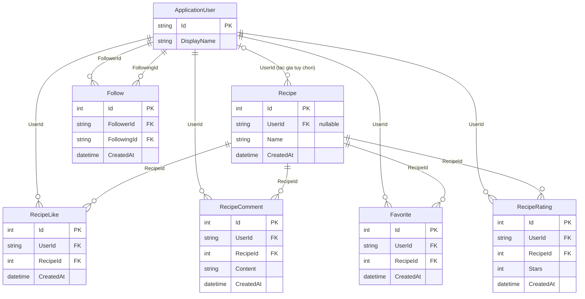

# CookShare Database Design

## 1. Giới thiệu

CookShare sử dụng PostgreSQL (Neon), Entity Framework Core 8 và Npgsql trên ASP.NET Core MVC (.NET 8). Tài khoản được mô hình hóa bằng ASP.NET Core Identity với `ApplicationUser` kế thừa `IdentityUser` và `ApplicationDbContext` kế thừa `IdentityDbContext<ApplicationUser>`.

Tài liệu mô tả schema trong mã nguồn, đối chiếu với [ApplicationDbContext](../CookShare/Data/ApplicationDbContext.cs), các [model](../CookShare/Models/) và migration [AddCoreDatabaseSchema](../CookShare/Migrations/20261021233038_AddCoreDatabaseSchema.cs). Trạng thái áp dụng lên database thực tế cần được kiểm tra riêng.

`Recipes.UserId` hiện cho phép `NULL` để bảo toàn công thức cũ chưa có tác giả. Khi triển khai Issue #75, nhóm cần thống nhất cách gán tác giả cho dữ liệu cũ, xử lý hết các bản ghi liên quan rồi mới chuyển trường này sang bắt buộc.

## 2. Danh sách Entity

| Entity | Bảng PostgreSQL | Chức năng |
| --- | --- | --- |
| ApplicationUser | AspNetUsers | Tài khoản, hồ sơ và thông tin xác thực Identity. |
| Recipe | Recipes | Công thức nấu ăn và tác giả nếu đã được gán. |
| RecipeLike | RecipeLikes | Lượt thích công thức của người dùng. |
| RecipeComment | RecipeComments | Bình luận của người dùng về công thức. |
| Favorite | Favorites | Công thức được người dùng lưu vào danh sách yêu thích. |
| Follow | Follows | Quan hệ có hướng giữa người theo dõi và người được theo dõi. |
| RecipeRating | RecipeRatings | Đánh giá công thức bằng số sao. |

Identity còn tạo `AspNetRoles`, `AspNetRoleClaims`, `AspNetUserClaims`, `AspNetUserLogins`, `AspNetUserRoles` và `AspNetUserTokens` để lưu vai trò, claim, đăng nhập bên ngoài và token.

## 3. Thiết kế chi tiết các bảng

Trong các bảng dưới đây, cột **NULL** mô tả khả năng nhận `NULL` tại database. `PK` là khóa chính, `FK` là khóa ngoại; dấu `—` nghĩa là không thuộc hai loại khóa này. Các `Id` kiểu `integer` của entity nghiệp vụ được sinh bằng PostgreSQL identity (`GENERATED BY DEFAULT AS IDENTITY`).

Các trường `CreatedAt` trong model có bộ khởi tạo `DateTime.UtcNow`. Đây là giá trị ở phía C#, không phải cấu hình mặc định `CURRENT_TIMESTAMP` trong database. Trường hợp dữ liệu `Recipes` cũ được mô tả riêng tại mục 8.

### 3.1. ApplicationUser

Bảng: `AspNetUsers`. Gồm các trường riêng của CookShare và các trường kế thừa từ `IdentityUser`.

| Trường | Kiểu C# | Kiểu PostgreSQL | NULL | Khóa | Chức năng |
| --- | --- | --- | --- | --- | --- |
| Id | string | text | Không | PK | Định danh tài khoản do Identity quản lý. |
| DisplayName | string? | character varying(100) | Có | — | Tên hiển thị trên hồ sơ. |
| AvatarUrl | string? | character varying(500) | Có | — | Đường dẫn ảnh đại diện. |
| CreatedAt | DateTime | timestamp with time zone | Không | — | Thời điểm tạo tài khoản. |
| UserName | string? | character varying(256) | Có | — | Tên đăng nhập. |
| NormalizedUserName | string? | character varying(256) | Có | — | Tên đăng nhập đã chuẩn hóa, có unique index. |
| Email | string? | character varying(256) | Có | — | Địa chỉ email. |
| NormalizedEmail | string? | character varying(256) | Có | — | Email đã chuẩn hóa, có index không duy nhất. |
| EmailConfirmed | bool | boolean | Không | — | Trạng thái xác nhận email. |
| PasswordHash | string? | text | Có | — | Giá trị băm mật khẩu do Identity quản lý. |
| SecurityStamp | string? | text | Có | — | Dấu kiểm tra thay đổi thông tin bảo mật. |
| ConcurrencyStamp | string? | text | Có | — | Dấu kiểm soát cập nhật đồng thời. |
| PhoneNumber | string? | text | Có | — | Số điện thoại. |
| PhoneNumberConfirmed | bool | boolean | Không | — | Trạng thái xác nhận số điện thoại. |
| TwoFactorEnabled | bool | boolean | Không | — | Trạng thái bật xác thực hai yếu tố. |
| LockoutEnd | DateTimeOffset? | timestamp with time zone | Có | — | Thời điểm kết thúc khóa tài khoản. |
| LockoutEnabled | bool | boolean | Không | — | Tài khoản có được áp dụng cơ chế khóa hay không. |
| AccessFailedCount | int | integer | Không | — | Số lần đăng nhập thất bại được Identity ghi nhận. |

Navigation `Recipes` là tập các công thức của người dùng; không tạo thêm cột trong `AspNetUsers`.

### 3.2. Recipe

Bảng: `Recipes`.

| Trường | Kiểu C# | Kiểu PostgreSQL | NULL | Khóa | Chức năng |
| --- | --- | --- | --- | --- | --- |
| Id | int | integer | Không | PK | Định danh công thức. |
| Name | string | character varying(200) | Không | — | Tên món ăn. |
| Description | string | text | Không | — | Mô tả công thức. |
| Image | string? | text | Có | — | Đường dẫn ảnh món ăn. |
| Ingredients | string | text | Không | — | Danh sách nguyên liệu. |
| Instructions | string | text | Không | — | Hướng dẫn chế biến. |
| Category | string | character varying(100) | Không | — | Danh mục món ăn. |
| UserId | string? | character varying(450) | Có | FK → AspNetUsers.Id | Tác giả; cho phép chưa được gán đối với dữ liệu cũ. |
| CreatedAt | DateTime | timestamp with time zone | Không | — | Thời điểm tạo công thức. |

Navigation: `User` có thể không có; `Likes`, `Comments`, `Favorites`, `Ratings` là các tập bản ghi liên quan và được khởi tạo bằng danh sách rỗng. Chúng không phải cột dữ liệu riêng.

### 3.3. RecipeLike

Bảng: `RecipeLikes`.

| Trường | Kiểu C# | Kiểu PostgreSQL | NULL | Khóa | Chức năng |
| --- | --- | --- | --- | --- | --- |
| Id | int | integer | Không | PK | Định danh lượt thích. |
| UserId | string | text | Không | FK → AspNetUsers.Id | Người thích công thức. |
| RecipeId | int | integer | Không | FK → Recipes.Id | Công thức được thích. |
| CreatedAt | DateTime | timestamp with time zone | Không | — | Thời điểm thích. |

Navigation: `User`, `Recipe`. Cặp `(UserId, RecipeId)` phải duy nhất.

### 3.4. RecipeComment

Bảng: `RecipeComments`.

| Trường | Kiểu C# | Kiểu PostgreSQL | NULL | Khóa | Chức năng |
| --- | --- | --- | --- | --- | --- |
| Id | int | integer | Không | PK | Định danh bình luận. |
| UserId | string | text | Không | FK → AspNetUsers.Id | Người viết bình luận. |
| RecipeId | int | integer | Không | FK → Recipes.Id | Công thức nhận bình luận. |
| Content | string | character varying(1000) | Không | — | Nội dung bình luận, tối đa 1.000 ký tự. |
| CreatedAt | DateTime | timestamp with time zone | Không | — | Thời điểm bình luận. |

Navigation: `User`, `Recipe`. Một người dùng có thể viết nhiều bình luận trên cùng công thức; không có unique index trên cặp `(UserId, RecipeId)`.

### 3.5. Favorite

Bảng: `Favorites`.

| Trường | Kiểu C# | Kiểu PostgreSQL | NULL | Khóa | Chức năng |
| --- | --- | --- | --- | --- | --- |
| Id | int | integer | Không | PK | Định danh lần lưu yêu thích. |
| UserId | string | text | Không | FK → AspNetUsers.Id | Người lưu công thức. |
| RecipeId | int | integer | Không | FK → Recipes.Id | Công thức được lưu. |
| CreatedAt | DateTime | timestamp with time zone | Không | — | Thời điểm lưu. |

Navigation: `User`, `Recipe`. Cặp `(UserId, RecipeId)` phải duy nhất.

### 3.6. Follow

Bảng: `Follows`.

| Trường | Kiểu C# | Kiểu PostgreSQL | NULL | Khóa | Chức năng |
| --- | --- | --- | --- | --- | --- |
| Id | int | integer | Không | PK | Định danh quan hệ theo dõi. |
| FollowerId | string | text | Không | FK → AspNetUsers.Id | Người thực hiện theo dõi. |
| FollowingId | string | text | Không | FK → AspNetUsers.Id | Người được theo dõi. |
| CreatedAt | DateTime | timestamp with time zone | Không | — | Thời điểm bắt đầu theo dõi. |

Navigation: `Follower`, `Following`. Cặp `(FollowerId, FollowingId)` phải duy nhất và hai giá trị phải khác nhau. A theo dõi B không đồng nghĩa B theo dõi A.

### 3.7. RecipeRating

Bảng: `RecipeRatings`.

| Trường | Kiểu C# | Kiểu PostgreSQL | NULL | Khóa | Chức năng |
| --- | --- | --- | --- | --- | --- |
| Id | int | integer | Không | PK | Định danh đánh giá. |
| UserId | string | text | Không | FK → AspNetUsers.Id | Người đánh giá. |
| RecipeId | int | integer | Không | FK → Recipes.Id | Công thức được đánh giá. |
| Stars | int | integer | Không | — | Số sao, từ 1 đến 5. |
| CreatedAt | DateTime | timestamp with time zone | Không | — | Thời điểm tạo đánh giá. |

Navigation: `User`, `Recipe`. Cặp `(UserId, RecipeId)` phải duy nhất; thay đổi số sao được thực hiện bằng cập nhật bản ghi đã có.

## 4. Sơ đồ ERD

Sơ đồ tập trung vào bảy entity nghiệp vụ. `ApplicationUser` tương ứng với bảng `AspNetUsers`; các bảng hỗ trợ Identity được liệt kê tại mục 5.



## 5. Primary Keys và Foreign Keys

`AspNetUsers` dùng `Id` kiểu `text` làm PK. Sáu bảng nghiệp vụ còn lại dùng `Id` kiểu `integer` làm PK. Các FK nghiệp vụ:

| Bảng chứa FK | Cột FK | Bảng và cột được tham chiếu | NULL |
| --- | --- | --- | --- |
| Recipes | UserId | AspNetUsers.Id | Có |
| RecipeLikes | UserId; RecipeId | AspNetUsers.Id; Recipes.Id | Không |
| RecipeComments | UserId; RecipeId | AspNetUsers.Id; Recipes.Id | Không |
| Favorites | UserId; RecipeId | AspNetUsers.Id; Recipes.Id | Không |
| Follows | FollowerId; FollowingId | AspNetUsers.Id; AspNetUsers.Id | Không |
| RecipeRatings | UserId; RecipeId | AspNetUsers.Id; Recipes.Id | Không |

Mỗi cột FK trong cùng hàng là một FK độc lập. Giá trị khác `NULL` phải tham chiếu đến bản ghi tồn tại; không có quan hệ FK ghép trong bảng trên.

Các bảng hỗ trợ Identity:

| Bảng | PK | FK |
| --- | --- | --- |
| AspNetRoles | Id (`text`) | Không có. |
| AspNetRoleClaims | Id (`integer`, identity) | RoleId → AspNetRoles.Id. |
| AspNetUserClaims | Id (`integer`, identity) | UserId → AspNetUsers.Id. |
| AspNetUserLogins | (LoginProvider, ProviderKey) | UserId → AspNetUsers.Id. |
| AspNetUserRoles | (UserId, RoleId) | UserId → AspNetUsers.Id; RoleId → AspNetRoles.Id. |
| AspNetUserTokens | (UserId, LoginProvider, Name) | UserId → AspNetUsers.Id. |

Các thành phần PK ghép và các FK Identity trong bảng này đều có kiểu `text` và không cho phép `NULL`.

## 6. Ràng buộc dữ liệu

Unique indexes ngăn bản ghi trùng ở cấp database:

| Index | Bảng / cột | Ý nghĩa |
| --- | --- | --- |
| IX_RecipeLikes_UserId_RecipeId | RecipeLikes (UserId, RecipeId) | Mỗi người chỉ thích một công thức một lần. |
| IX_Favorites_UserId_RecipeId | Favorites (UserId, RecipeId) | Mỗi người chỉ lưu một công thức một lần. |
| IX_RecipeRatings_UserId_RecipeId | RecipeRatings (UserId, RecipeId) | Mỗi người có tối đa một đánh giá cho mỗi công thức. |
| IX_Follows_FollowerId_FollowingId | Follows (FollowerId, FollowingId) | Không lặp cùng một quan hệ theo dõi có hướng. |
| UserNameIndex | AspNetUsers (NormalizedUserName) | Tên đăng nhập chuẩn hóa khác NULL phải duy nhất. |
| RoleNameIndex | AspNetRoles (NormalizedName) | Tên vai trò chuẩn hóa khác NULL phải duy nhất. |

`EmailIndex` trên `AspNetUsers.NormalizedEmail` không phải unique index; schema hiện chưa buộc email duy nhất. Các index không duy nhất còn hỗ trợ tra cứu theo `Recipes.UserId`, `RecipeId` của các bảng tương tác, `RecipeComments.UserId`, `Follows.FollowingId` và các FK Identity chưa được bao phủ bởi PK/index phù hợp.

Check constraints:

| Constraint | Biểu thức SQL | Ý nghĩa |
| --- | --- | --- |
| CK_Follows_NoSelfFollow | `"FollowerId" <> "FollowingId"` | Không cho phép tự theo dõi. |
| CK_RecipeRatings_Stars | `"Stars" >= 1 AND "Stars" <= 5` | Chỉ chấp nhận từ 1 đến 5 sao. |

Giới hạn độ dài và khả năng nhận `NULL` áp dụng theo mục 3. Ngoài ra, Data Annotations `[Required]` kiểm tra các trường bắt buộc của `Recipe` và `RecipeComment.Content` tại tầng validation. `NOT NULL` trong database chỉ chặn `NULL`, không tự chặn chuỗi rỗng hoặc chỉ chứa khoảng trắng; schema hiện không có check constraint cho các trường hợp đó. `Stars` hiện được giới hạn bởi check constraint, chưa có `[Range]` trên model.

## 7. Delete Behavior

Các hành vi dưới đây áp dụng khi xóa bản ghi cha được FK tham chiếu.

| Bản ghi cha | Bản ghi con / FK | Hành vi |
| --- | --- | --- |
| AspNetUsers | Recipes.UserId | Restrict |
| AspNetUsers | RecipeLikes.UserId | Restrict |
| AspNetUsers | RecipeComments.UserId | Restrict |
| AspNetUsers | Favorites.UserId | Restrict |
| AspNetUsers | RecipeRatings.UserId | Restrict |
| AspNetUsers | Follows.FollowerId và Follows.FollowingId | Restrict cho cả hai FK |
| Recipes | RecipeLikes.RecipeId | Cascade |
| Recipes | RecipeComments.RecipeId | Cascade |
| Recipes | Favorites.RecipeId | Cascade |
| Recipes | RecipeRatings.RecipeId | Cascade |
| AspNetUsers | AspNetUserClaims, AspNetUserLogins, AspNetUserRoles, AspNetUserTokens qua UserId | Cascade |
| AspNetRoles | AspNetRoleClaims và AspNetUserRoles qua RoleId | Cascade |

**Restrict:** database từ chối xóa người dùng nếu vẫn còn bản ghi tham chiếu tới người đó qua các FK nghiệp vụ. Cấu hình này bảo vệ công thức và lịch sử tương tác khỏi việc bị xóa tự động theo tài khoản. Luồng xóa tài khoản cần chủ động xử lý các tham chiếu trước khi xóa người dùng. Riêng `Recipes.UserId` hiện có thể được gán `NULL` hoặc chuyển sang tác giả khác nếu phù hợp với chính sách dữ liệu; `Restrict` không cấu hình `ON DELETE SET NULL`. Các FK nghiệp vụ khác là bắt buộc nên không thể giải quyết bằng cách gán `NULL`.

**Cascade:** khi xóa công thức, database tự xóa lượt thích, bình luận, yêu thích và đánh giá tham chiếu đến công thức đó, tránh để lại bản ghi mồ côi. Việc xóa một lượt thích hoặc bình luận không xóa công thức hay tài khoản. Các bản ghi hỗ trợ Identity được xóa theo người dùng hoặc vai trò tương ứng, nhưng những FK nghiệp vụ dùng `Restrict` vẫn có thể chặn thao tác xóa người dùng.

## 8. EF Core Migrations

| Migration | Thay đổi |
| --- | --- |
| 20261021221134_InitialCreate | Tạo bảng Recipes với các trường công thức ban đầu. |
| 20261021233038_AddCoreDatabaseSchema | Thêm Recipes.UserId, Recipes.CreatedAt; tạo các bảng Identity và tương tác cùng PK, FK, index và check constraint. |

`Up()` của `AddCoreDatabaseSchema` chỉ bổ sung cột, index và FK vào `Recipes`; không xóa, tạo lại bảng hoặc xóa các công thức cũ. `UserId` cho phép `NULL` nên dữ liệu cũ chưa cần có tài khoản tác giả.

`CreatedAt` của công thức cũ nhận giá trị mặc định `DateTime.MinValue` trong migration hiện tại. SQL đã sinh trong [migration-review.sql](../migration-review.sql) biểu diễn giá trị này bằng `TIMESTAMPTZ '-infinity'`. Vì vậy, migration chưa gán ngày tạo có ý nghĩa cho công thức cũ và chưa cấu hình mặc định thời gian hiện tại tại database. Nhóm cần thống nhất cách xử lý ngày tạo cũ trước khi dùng trường này để sắp xếp hoặc thống kê.

Các lệnh dưới đây chạy từ thư mục gốc repository. Để tạo migration cho thay đổi model trong tương lai và xuất SQL để kiểm tra:

```powershell
dotnet ef migrations add <TenMigration> --project CookShare\CookShare.csproj
dotnet ef migrations script --idempotent --project CookShare\CookShare.csproj --output migration-review.sql
```

Kiểm tra migration mới trên Neon Development branch trước khi áp dụng cho môi trường khác. Sau khi xác nhận connection string trỏ đúng database và đã rà soát SQL, áp dụng bằng:

```powershell
dotnet ef database update --project CookShare\CookShare.csproj
```

EF Core theo dõi migration đã áp dụng bằng `__EFMigrationsHistory`. Script hiện tại chứa cả `InitialCreate` và `AddCoreDatabaseSchema`, nên có đoạn tạo `Recipes` dành cho database mới. Với database đã có `Recipes`, bản ghi lịch sử `InitialCreate` cần tồn tại để script bỏ qua đoạn này; không thể chỉ dựa vào việc bảng đã tồn tại.

`Down()` của `AddCoreDatabaseSchema` giữ bảng `Recipes` nhưng xóa hai cột mới và các bảng mới, làm mất dữ liệu trong các cấu trúc bị xóa. Cần đánh giá dữ liệu trước khi rollback. Việc cập nhật tài liệu này không áp dụng hoặc rollback migration trên database.

## 9. Kết quả kiểm thử

Kiểm tra mã nguồn ngày 22/10/2026 bằng lệnh:

```powershell
dotnet test CookShare.sln --no-restore
```

| Phạm vi | Kết quả |
| --- | --- |
| Build ứng dụng và dự án kiểm thử trong lệnh test | Thành công; còn cảnh báo EnableGenerateDocumentationFile, CA1725 và CA1861. |
| RecipeTests | 7 ca đạt: công thức hợp lệ, 5 trường bắt buộc và ảnh tùy chọn. |
| RecipeControllerTests | 9 ca đạt: trả về view và truyền RecipeId. |
| ProfileControllerTests | 4 ca đạt: truyền TargetUserId khi có hoặc không có tham số. |
| UnitTest1.Test1 | 1 ca đạt nhưng chưa có assertion, không chứng minh hành vi nghiệp vụ. |
| Tổng số ca kiểm thử hiện có | 21 đạt, 0 thất bại, 0 bỏ qua. |
| Rà soát tĩnh migration và SQL | Có đủ bảng, FK, unique indexes và check constraints; Up() của AddCoreDatabaseSchema không tạo lại Recipes. |
| Áp dụng migration và kiểm thử tích hợp PostgreSQL/Neon | Chưa thực hiện trong lần kiểm tra này. |

Bộ test hiện tại chưa xác minh việc database thực thi unique indexes, FK, check constraints, `Restrict`, `Cascade` hoặc bảo toàn dữ liệu cũ. Trên Neon Development branch, cần kiểm tra các trường hợp: trùng Like/Favorite/Rating/Follow, tự Follow, số sao ngoài 1–5, FK không tồn tại, xóa người dùng còn tham chiếu, xóa công thức kèm tương tác và nâng cấp database đã có công thức chưa gán tác giả. Các trường hợp này chưa được ghi nhận là đã đạt.

## 10. Hướng phát triển tiếp theo

- Triển khai Authentication trong Issue #75: đăng ký các dịch vụ Identity và middleware xác thực, gắn công thức mới với tài khoản đăng nhập và kiểm tra quyền sửa/xóa theo tác giả.
- Trong Issue #75, thống nhất chính sách gán tác giả cho công thức cũ, cập nhật dữ liệu, xác minh không còn `Recipes.UserId IS NULL` và không có FK không hợp lệ, rồi mới đổi model/cấu hình sang bắt buộc và tạo migration đặt `UserId` là `NOT NULL`. Không chuyển sang bắt buộc trước khi xử lý dữ liệu cũ.
- Thống nhất cách gán `CreatedAt` cho công thức cũ đang có giá trị `-infinity`, đồng thời quyết định có cần giá trị mặc định ở database hay không.
- Bổ sung kiểm thử tích hợp PostgreSQL cho migrations, các ràng buộc dữ liệu và hành vi xóa nêu tại mục 9.
- Hoàn thiện validation đầu vào cho số sao, độ dài và nội dung; thống nhất yêu cầu email duy nhất nếu sản phẩm cần.
- Thiết kế chính sách xóa tài khoản hoặc vô hiệu hóa tài khoản phù hợp với các FK dùng `Restrict`, và đánh giá thêm index theo truy vấn thực tế khi triển khai các chức năng tương tác.
