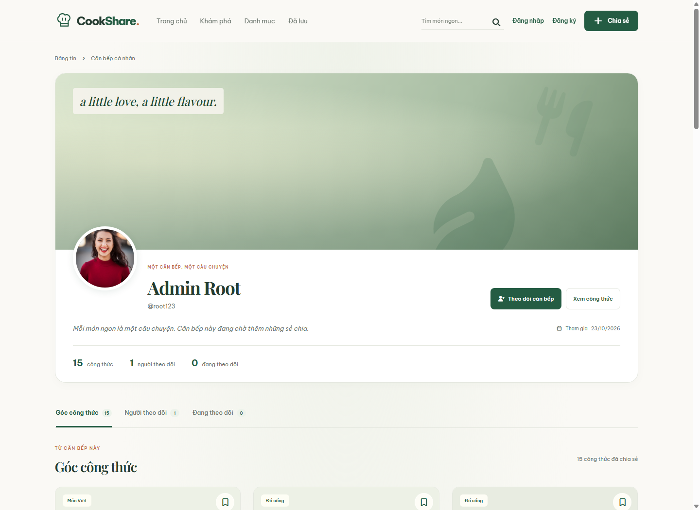
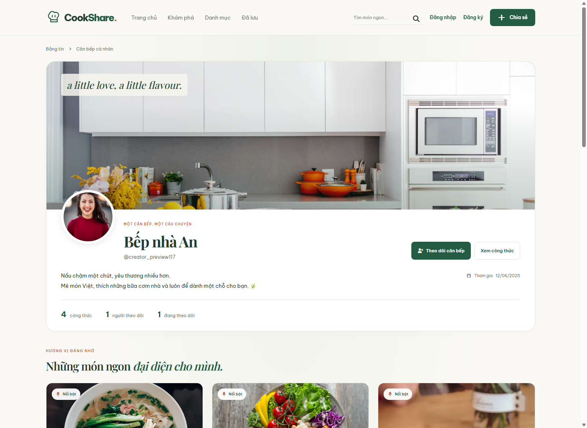
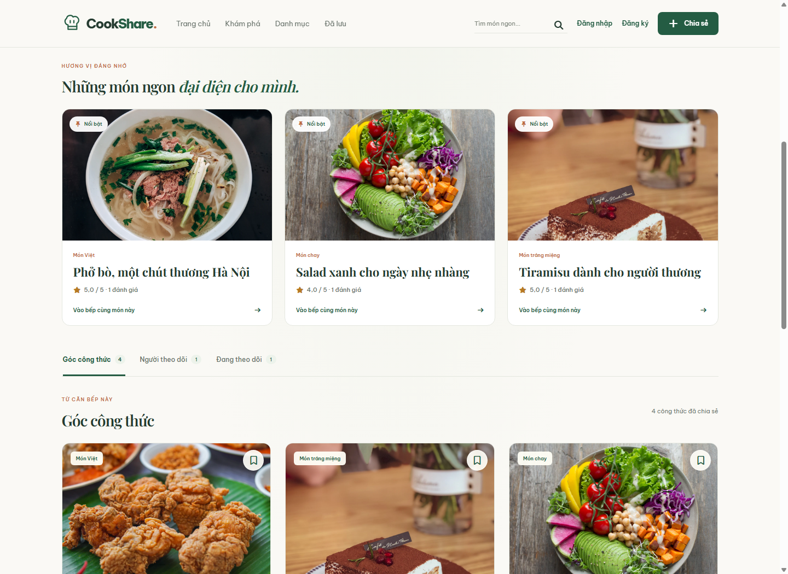

# Issue #117 — Creator Profile review

Before/After được chụp trên cùng một hồ sơ hiện có, không thay đổi Bio, ảnh hay công thức của tài khoản đó. Bản Before là giao diện trước issue #117; bản After thêm cover mặc định, header, stats và tab mới. Màn hình đầy đủ nội dung bên dưới dùng tài khoản fixture riêng trên PostgreSQL kiểm thử, với công thức và rating được lưu thật trong database này.

## Before / After

| Kích thước | Before | After |
| --- | --- | --- |
| Desktop 1440px | [Xem ảnh](profile-before-desktop.png) | [Xem ảnh](profile-after-desktop.png) |
| Tablet 768px | [Xem ảnh](profile-before-tablet.png) | [Xem ảnh](profile-after-tablet.png) |
| Mobile 360px | [Xem ảnh](profile-before-mobile.png) | [Xem ảnh](profile-after-mobile.png) |

### Desktop sau thay đổi

## Bio, ảnh bìa và công thức nổi bật

| Màn hình | Desktop 1440px | Mobile 360px |
| --- | --- | --- |
| Profile chủ tài khoản | [Xem ảnh](example-owner-desktop.png) | [Xem ảnh](example-owner-mobile.png) |
| Quản lý ghim, đổi thứ tự | [Xem ảnh](example-manager-desktop.png) | [Xem ảnh](example-manager-mobile.png) |
| Chỉnh sửa và xem trước | [Xem ảnh](example-editor-desktop.png) | [Xem ảnh](example-editor-mobile.png) |

## Kiểm chứng

- Full-page kiểm tra tại 1440px, 768px và 360px: không tràn ngang.
- Đăng nhập bằng cookie thật; native form lưu Bio, đổi thứ tự và bỏ ghim; tải lại xác nhận dữ liệu đã lưu.
- Khách xem không có tab Favorites hoặc nút quản lý; chủ tài khoản có đầy đủ thao tác.
- URL ảnh bìa không tải được có phản hồi và fallback; reduced motion tắt animation; không có lỗi JavaScript.
- [Kết quả 24 kiểm tra trên ứng dụng chạy thật](live-verification.json). Kiểm thử trình duyệt module và .NET được mô tả tại [CREATOR_PROFILE.md](../../CREATOR_PROFILE.md).

Fixture dùng riêng cho ảnh review và được dọn sau kiểm tra; không seed Profile vào database Development. Maintainer có thể dùng [hướng dẫn kiểm thử thủ công](../../CREATOR_PROFILE.md#kiểm-thử-bằng-giao-diện) để đánh giá quyền sở hữu và luồng lưu.
