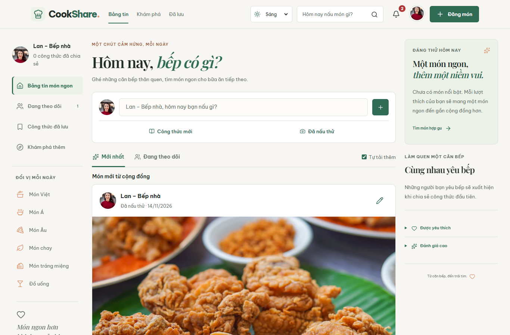
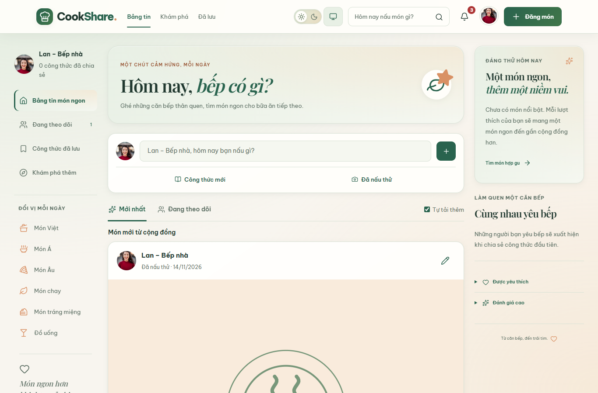
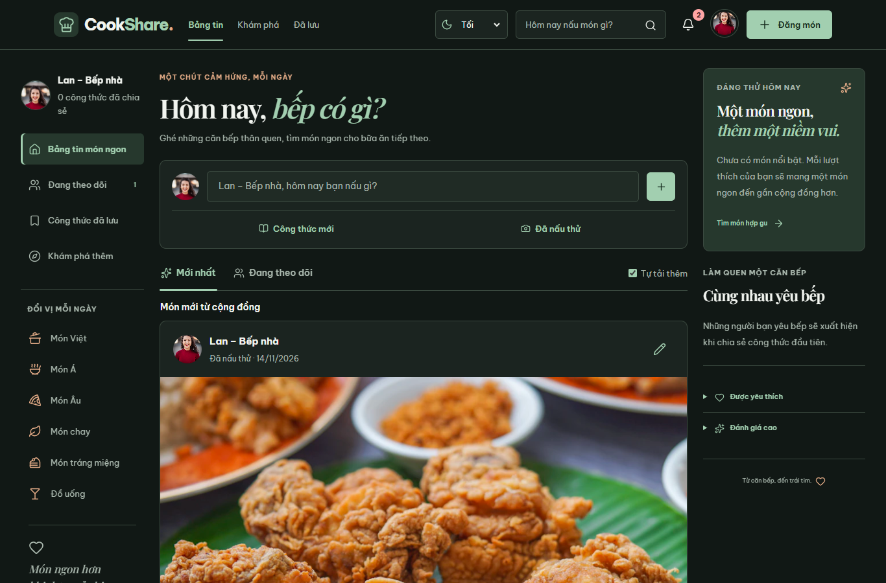
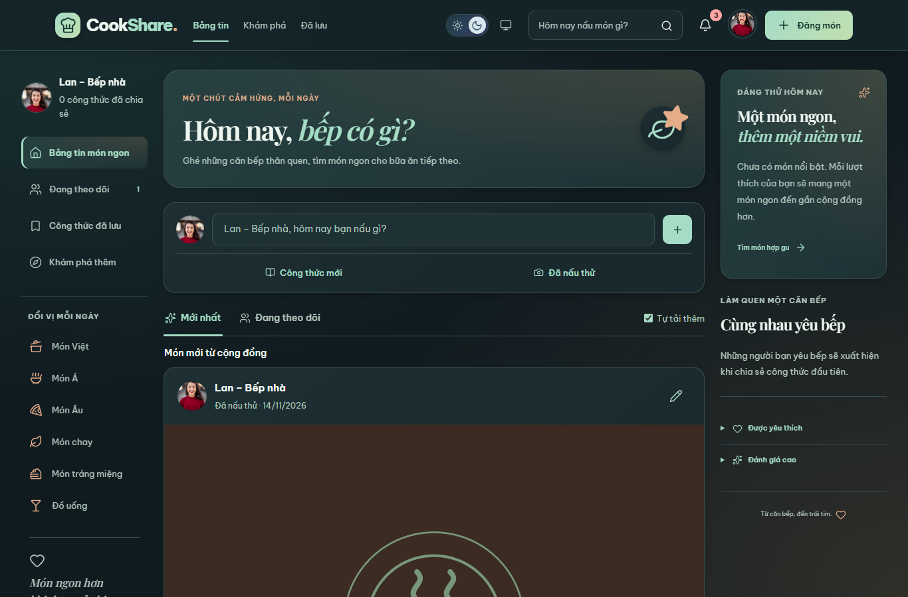
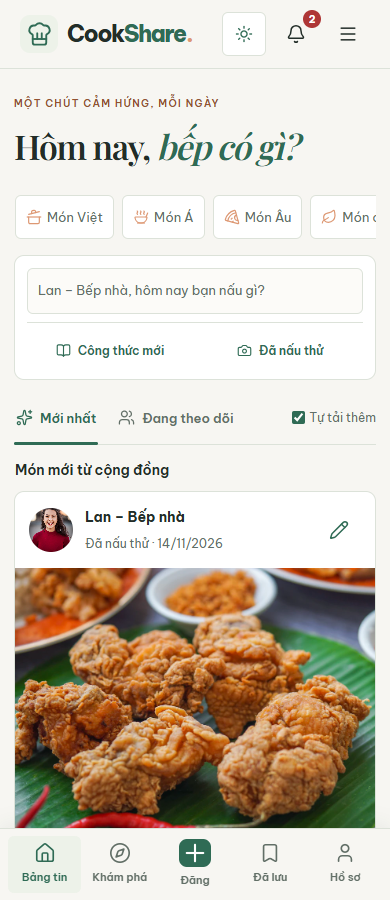
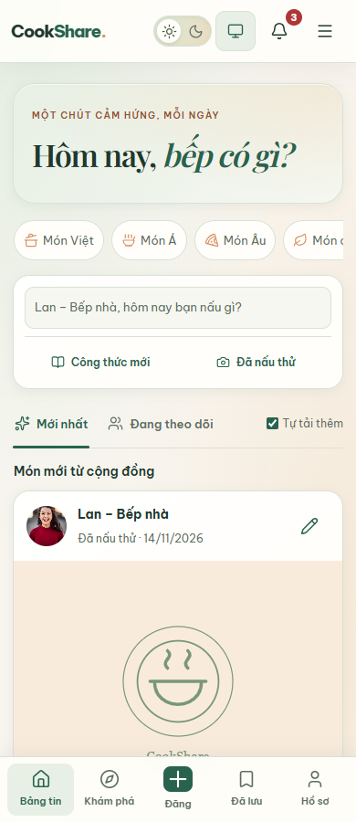
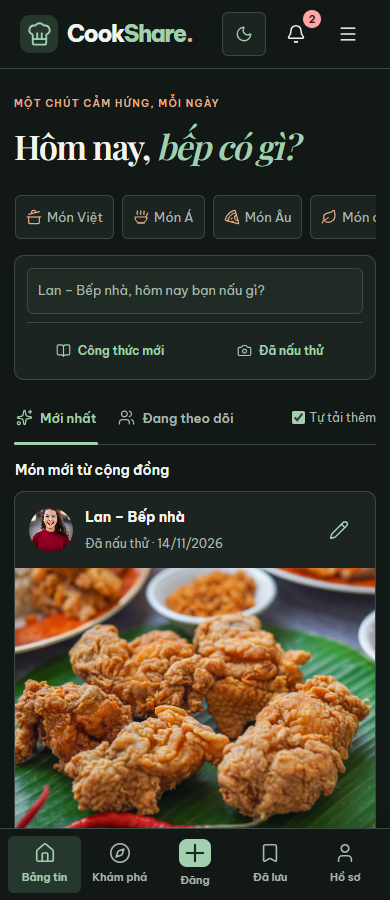
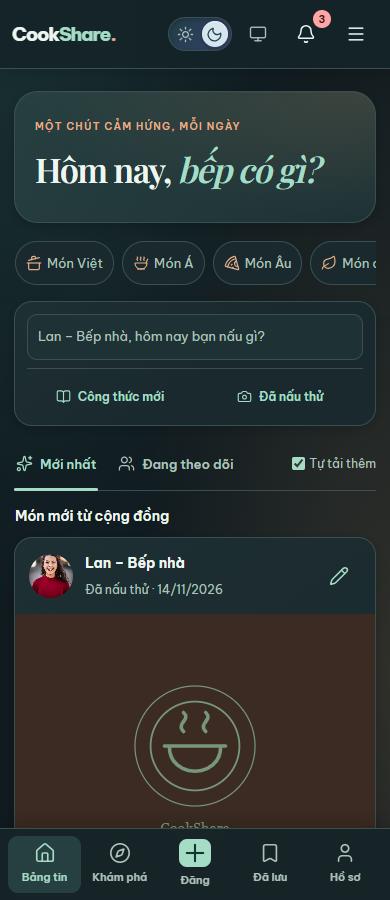

# Theme refresh — ảnh trước/sau

Ảnh Chrome headless ngày 17/11/2026. Bên trái là ảnh lưu từ Premium V2
(`1c68005`), bên phải là theme refresh. Dữ liệu tài khoản, công thức và ảnh là
fixture kiểm thử PostgreSQL trên loopback, không phải dữ liệu production.
Các lần kiểm tra tương tác làm thay đổi thứ tự bài/thông báo; dùng ảnh để so
sánh màu, bề mặt và bố cục, không coi là so sánh pixel với state cố định.

| Giao diện | Trước | Sau |
| --- | --- | --- |
| Sáng · desktop 1366×900 |  |  |
| Tối · desktop 1366×900 |  |  |
| Sáng · mobile 390×900 |  |  |
| Tối · mobile 390×900 |  |  |

Ảnh là viewport, không phải toàn trang. [Hành vi và kết quả kiểm chứng](../../THEME_REFRESH.md).
